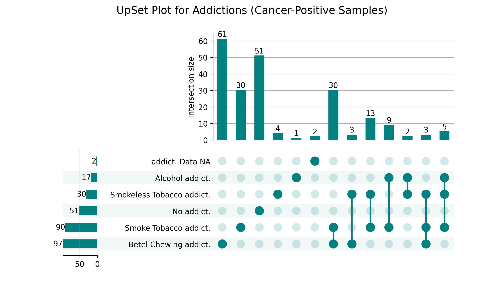

# Genomic Exploration of HPV‑Associated Head & Neck Squamous Cell Carcinoma in Bangladesh
**An Integrative Histopathological Analysis and Molecular Profiling of HPV**

> **Status:** Ongoing research. Primary datasets are withheld until publication.  
> **Scope:** This repository ships **analysis code**, **reproducible templates**, and **derived figures** only.

---

## 🧭 Table of Contents
- [Overview](#-overview)
- [Repository Structure](#-repository-structure)
- [Wet Lab Panels](#-wet-lab-panels)
- [HNSCC Figures (Clinical, Python)](#-hnscc-figures-clinical-python)
- [HPV Typing Figures](#-hpv-typing-figures)
- [Code (Notebooks)](#-code-notebooks)
- [ML: Clinical Modeling with PyCaret](#-ml-clinical-modeling-with-pycaret)
- [Quick Start](#-quick-start)
- [Reproduce Key Plots (Code)](#-reproduce-key-plots-code)
- [Reproducibility Checklist](#-reproducibility-checklist)
- [Data Availability](#-data-availability)
- [Citation](#-citation)
- [License](#-license)
- [Acknowledgements](#-acknowledgements)
- [Changelog](#-changelog)

---

## 📖 Overview
This repository documents an integrative study combining **clinical metadata**, **histopathology**, **HPV molecular typing**, and **machine‑learning** to investigate HPV’s role in **Head & Neck Squamous Cell Carcinoma (HNSCC)** in Bangladesh.

**Highlights**
- Clinical cohort curation and histopathological review  
- Genomic exploration of **HPV‑positive** cases (focus on high‑risk types)  
- IHC markers and protein expression profiling  
- ML models for **risk stratification** and **feature importance**

> **Note:** Only scripts, notebooks, and representative figures are shared. Raw/CSV data are excluded pre‑publication.

---

---

## 🔬 Wet Lab Panels
Representative documentation images. Replace/update with finalized panels as the project evolves.

### Histopathological Analysis  

### Paraffin Embedded Tissue  

### Pre‑sampling Procedure  

### Punch Biopsy  

---

## 📈 HNSCC Figures (Clinical, Python)
**Addictions_UpSet_Plot_Positive_Samples.png** — overlap of addictions/risk factors (e.g., Smoking, Alcohol, Betel quid, Smokeless tobacco) among **cancer‑positive** samples.

---

## 🧬 HPV Typing Figures
**HPV_Type_Distribution.png** — distribution of HPV types among HPV‑positive samples.

---

## 🧮 Code (Notebooks)
- **`SV_thesis_data_clean.ipynb`** → Data import, cleaning, preprocessing  
- **`SV_thesis_stat.ipynb`** → Cohort summaries, hypothesis tests, publication‑ready plots

> Cells that require restricted data are clearly marked. You can wire them to local paths once data access is granted.

---

## 🤖 ML: Clinical Modeling with PyCaret
We benchmark classifiers on the clinical cohort using **PyCaret**:
- Stratified cross‑validation
- Hyperparameter tuning
- Automatic plots: **AUROC** and **Feature Importance**

**Example Outputs**
- `ML/AUC.png` — AUROC of the finalized model  
- `ML/Feature Importance.png` — top predictors  
- `ML/logs.log` — session info & CV results

---

🚀 Quick Start
1) Create & activate a virtual environment

Linux / macOS

python -m venv .venv
source .venv/bin/activate

Windows (PowerShell)

python -m venv .venv
.venv\Scripts\Activate.ps1

2) Install dependencies
pip install "pycaret[classification]" pandas numpy matplotlib scipy statsmodels upsetplot jupyter

3) Launch notebooks
jupyter notebook Code/
