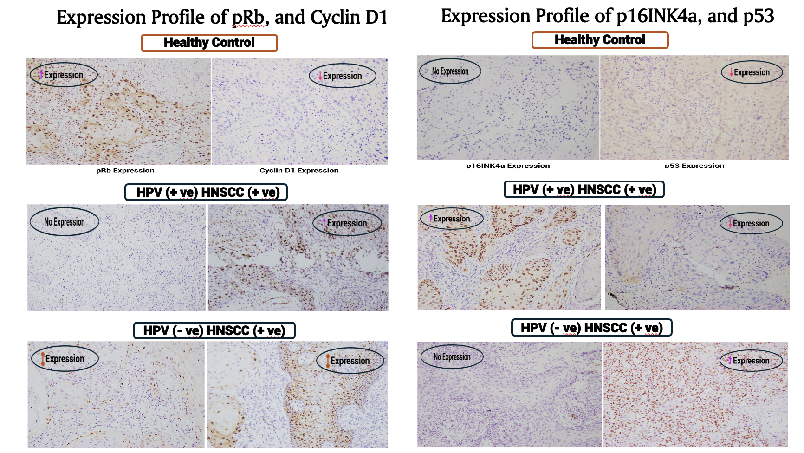
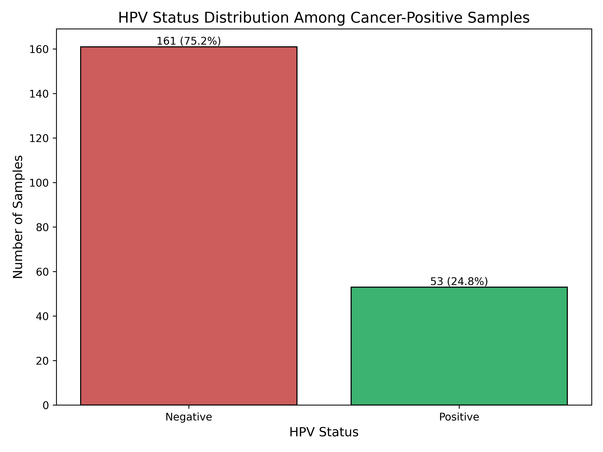
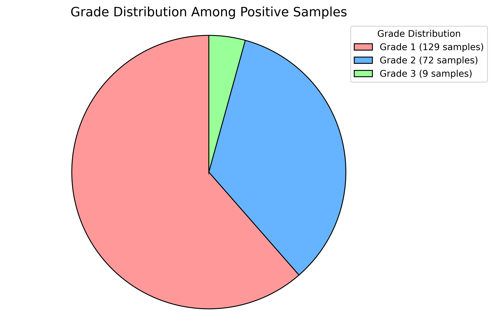
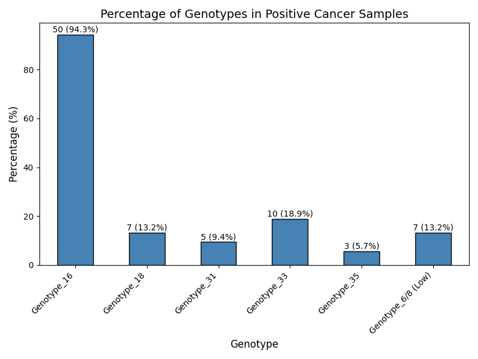
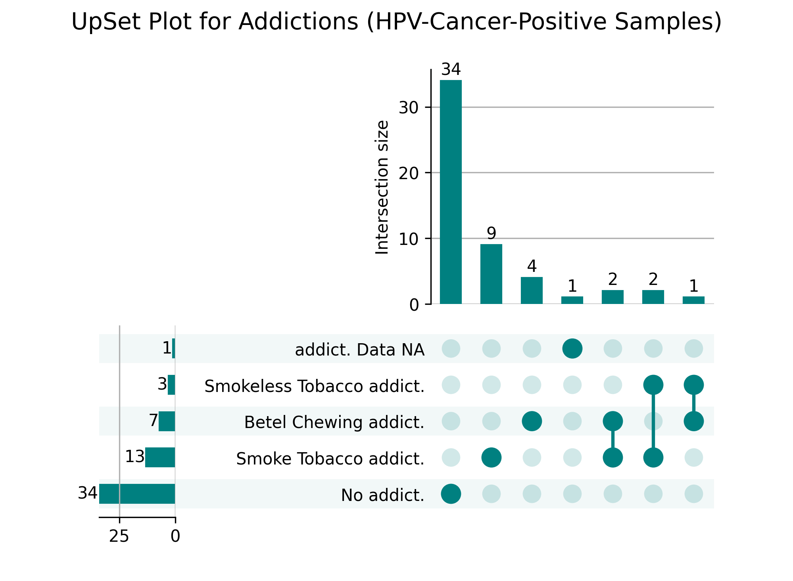
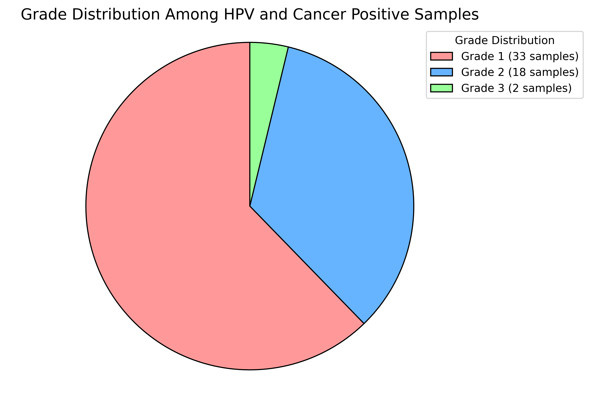
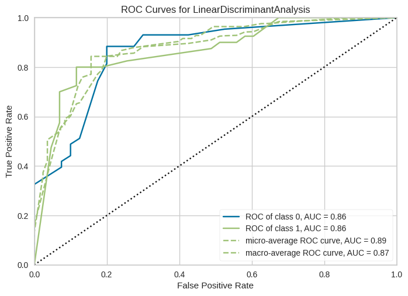

# Genomic Exploration of HPV-Associated Head Neck Squamous Cell Carcinoma Occurrence in Bangladesh: An Integrative Histopathological Analysis and Molecular Profiling of HPV

> **Status:** Ongoing research. Primary datasets are withheld until publication.

## 📖 Overview

This repository documents an integrative study combining **clinical metadata**, **histopathology**, **immunohistochemistry (IHC)**, **HPV molecular typing**, and **machine learning** to investigate HPV's role in **Head & Neck Squamous Cell Carcinoma (HNSCC)** in Bangladesh.

**Highlights**

- Clinical cohort curation and histopathological review
- Genomic exploration of **HPV-positive** cases (focus on high-risk types)
- IHC profiling of **pRb, Cyclin D1, p16INK4a, and p53**
- ML models for **risk stratification** and **feature importance**

> **Note:** Only scripts, notebooks, and representative figures are shared. Raw/CSV data are excluded pre-publication.

## 📑 Contents

1. [Repository Structure](#-repository-structure)
2. [Wet Lab Workflow](#-wet-lab-workflow)
3. [Immunohistochemistry Results](#-immunohistochemistry-results)
4. [Clinical Figures (HNSCC)](#-clinical-figures-hnscc)
5. [HPV Typing Figures](#-hpv-typing-figures)
6. [Machine Learning](#-machine-learning)
7. [Code](#-code)
8. [Quick Start](#-quick-start)

## 🗂 Repository Structure

```text
HNSCC-HPV/
├── Code/           # Data cleaning and statistics notebooks
├── HNSCC_Figure/   # Clinical figures for cancer-positive samples
├── HPV_Figure/     # Figures for HPV- and cancer-positive samples, HPV genotypes
├── ML/             # PyCaret script, notebook, logs, and output plots
└── Wet_Lab/        # Sampling, histopathology, and IHC panels
```

## 🔬 Wet Lab Workflow

Representative documentation images, in workflow order. Replace or update with finalized panels as the project evolves.

<table>
  <tr>
    <td align="center"><b>Pre-sampling Procedure</b><br/></td>
    <td align="center"><b>Punch Biopsy</b><br/></td>
  </tr>
  <tr>
    <td align="center"><b>Paraffin-Embedded Tissue</b><br/></td>
    <td align="center"><b>Histopathological Analysis</b><br/></td>
  </tr>
</table>

## 🧫 Immunohistochemistry Results

Expression of four cell-cycle and tumor-suppressor proteins was compared across healthy control tissue, HPV-positive HNSCC, and HPV-negative HNSCC.



| Group | pRb | Cyclin D1 | p16INK4a | p53 |
|---|:---:|:---:|:---:|:---:|
| **Healthy control** | ↑ | ↓ | None | ↓ |
| **HPV-positive HNSCC** | None | ↑ | ↑ | ↓ |
| **HPV-negative HNSCC** | ↕ | ↕ | None | ↑ |

**Key:** ↑ increased · ↓ decreased · ↕ intermediate · None = no expression

**Main observations**

- **HPV-positive HNSCC** showed strong p16INK4a with no detectable pRb and low p53. This pattern is consistent with the known actions of HPV E7 on pRb and HPV E6 on p53.
- **HPV-negative HNSCC** showed no p16INK4a and increased p53.
- **p16INK4a** was expressed only in the HPV-positive group among the three groups shown.

> These are representative fields, so the table is a qualitative summary rather than quantitative scoring across the cohort.

## 📈 Clinical Figures (HNSCC)

Figures in this section cover **cancer-positive** samples unless the title says otherwise.

**Addictions and risk factors:** overlap of smoked tobacco, smokeless tobacco, betel chewing, and alcohol use.


<table>
  <tr>
    <td align="center"><b>HPV Status</b><br/></td>
    <td align="center"><b>Tumor Grade</b><br/></td>
  </tr>
</table>

<details>
<summary><b>More clinical figures</b></summary>

- [Age and gender](HNSCC_Figure/Age_and_Gender_Analysis_Plot.png)
- [Gender distribution](HNSCC_Figure/Gender_Distribution_Square.png)
- [Marital status](HNSCC_Figure/Marital%20Status_Distribution_Square.png)
- [Education, occupation, and economic status](HNSCC_Figure/Education_Occupation_Economical_Distribution_Cancer_Positive.png)
- [Family status](HNSCC_Figure/Family_Status_Cancer_Positive_Samples.png)
- [Carcinoma status](HNSCC_Figure/Carcinoma_Status_Distribution_Square.png)
- [Tissue source, all samples](HNSCC_Figure/Tissue_Source_all_Samples.png)

</details>

## 🧬 HPV Typing Figures

**HPV genotype distribution:** genotype frequencies among HPV-positive cancer samples. Percentages can add up to more than 100% if a sample carries more than one genotype.



<table>
  <tr>
    <td align="center"><b>Addictions in HPV- and Cancer-Positive Samples</b><br/></td>
    <td align="center"><b>Tumor Grade in HPV- and Cancer-Positive Samples</b><br/></td>
  </tr>
</table>

<details>
<summary><b>More HPV figures</b></summary>

- [Age and gender](HPV_Figure/Age_and_Gender_Analysis_Plot.png)
- [Education, occupation, and economic status](HPV_Figure/Education_Occupation_Economical_Distribution_HPV_and_Cancer_Positive.png)
- [Family status](HPV_Figure/Family_Status_Cancer_Positive_Samples.png)
- [Carcinoma status](HPV_Figure/Carcinoma_Status_Distribution_HPV.png)

</details>

## 🤖 Machine Learning

Classifiers are benchmarked on the clinical cohort using **PyCaret** with:

- Stratified 5-fold cross-validation
- Hyperparameter tuning
- Automatic plots for **AUROC** and **feature importance**

<table>
  <tr>
    <td align="center"><b>Top Predictors (Feature Importance)</b><br/></td>
    <td align="center"><b>AUROC of the Finalized Model</b><br/></td>
  </tr>
</table>

| File | Purpose |
|---|---|
| [`ML/run_pycaret.py`](ML/run_pycaret.py) | Model benchmarking, tuning, and plots |
| [`ML/Ml_Cancer_SV_Thesis_8_Jan_25.ipynb`](ML/Ml_Cancer_SV_Thesis_8_Jan_25.ipynb) | ML notebook |
| [`ML/logs.log`](ML/logs.log) | Session information and cross-validation results |

## 🧮 Code

| Notebook | Purpose |
|---|---|
| [`Code/SV_thesis_data_clean.ipynb`](Code/SV_thesis_data_clean.ipynb) | Data import, cleaning, and preprocessing |
| [`Code/SV_thesis_stat.ipynb`](Code/SV_thesis_stat.ipynb) | Cohort summaries, hypothesis tests, and publication-ready plots |

> Cells that require restricted data are clearly marked. You can wire them to local paths once data access is granted.

## 🚀 Quick Start

**1. Create and activate a virtual environment**

Linux / macOS:

```bash
python -m venv .venv
source .venv/bin/activate
```

Windows (PowerShell):

```powershell
python -m venv .venv
.venv\Scripts\Activate.ps1
```

**2. Install dependencies**

```bash
pip install "pycaret[classification]" pandas numpy matplotlib scipy statsmodels upsetplot jupyter
```

**3. Launch the notebooks**

```bash
jupyter notebook Code/
```
